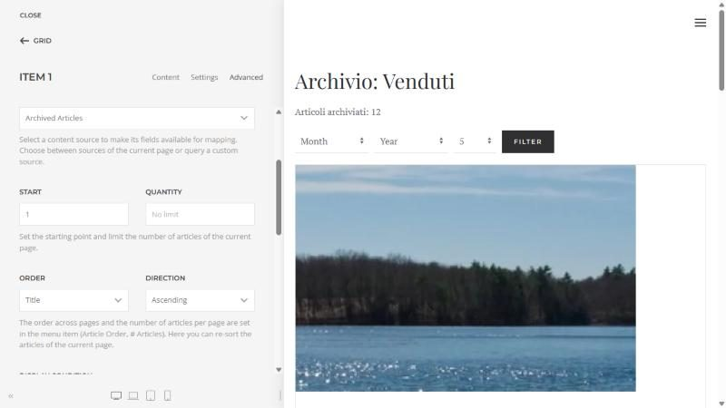
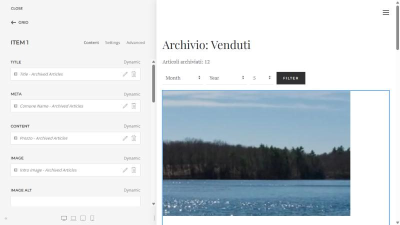
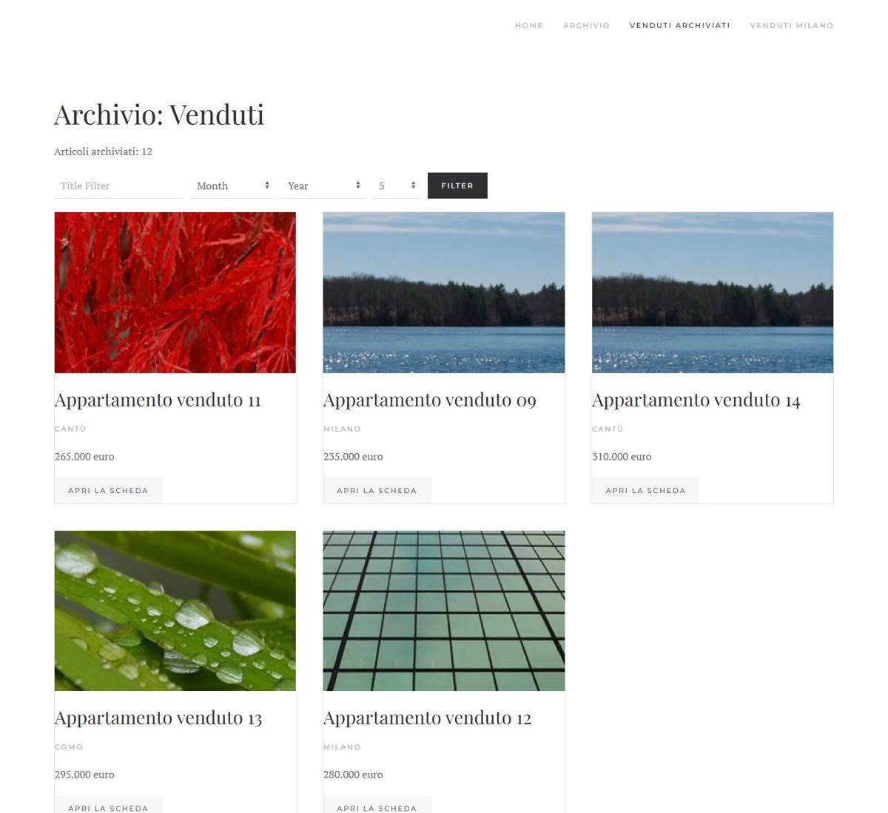
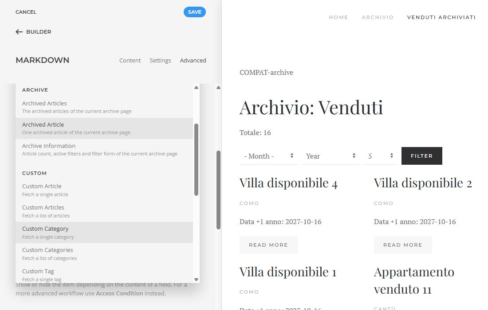

# Archive Layouts for YOOtheme: user guide

For **site managers**: install, build the archive page with the YOOtheme Pro builder, update,
uninstall. Everything from the Joomla and YOOtheme interfaces.
Italian version: [USO.md](./USO.md). Developers: [DEVELOPING.md](./DEVELOPING.md) (Italian).

## What it does

Joomla has an **Archived Articles** view (menu item *Articles > Archived Articles*), but
YOOtheme Pro cannot design it with the builder: you only get the standard list. This plugin
adds the **Archived Articles** template type to the builder, with the archived articles as
dynamic content (title, images, link, dates, category, author, tags and **all custom fields**),
pagination and the month and year filters.

Version 2.0 does only this: the layout. Keeping archived articles in one category automatically
is a different need and is now a separate plugin, **Auto Archive** (it works with or without
YOOtheme): see [Auto Archive](../autoarchive/USAGE.md) and
[Updating from 1.x](#updating-from-1x).

Requirements: Joomla 5 or 6, PHP 8.1+, YOOtheme Pro 5. Tested with YOOtheme Pro 5.0.51 on Joomla
6.2.0 and 5.4.10 (PHP 8.4), together with Essentials for YOOtheme Pro and 4SEO: see
[Tested compatibility](#tested-compatibility).

## 1. Install

1. Download `plg_system_yooarchive-X.Y.Z.zip` from the
   [releases](https://github.com/WebG-it/joomla-extensions/releases) or from `dist/`.
2. *System > Install > Extensions > Upload Package File*.
3. The plugin is enabled automatically. Nothing changes on the site until you create a
   template.

## 2. Build the archive page

1. Create (if missing) a menu item *Articles > Archived Articles*. In its options choose the
   categories (empty = all), the order (*Article Order*, *Date for Ordering*) and the number
   of articles per page (*# Articles*).
2. Open YOOtheme Pro (backend menu *YOOtheme*), item **TEMPLATES** in the left sidebar, button
   **NEW TEMPLATE**; in *Page* choose **Archived Articles**:
   - *Limit by Categories*: the template applies only to archive menu items filtered on
     those categories (with or without child categories). Empty = every archive page.
   - *Limit by Page Number* and *Limit by Language* as for the other templates.
3. Design the layout. In the *Dynamic Content* of an element (for example a Grid) choose the
   **Archive** group (**Archivio** in an Italian interface):
   - **Archived Articles**: the list of the current page. *Start* and *Quantity* take a part
     of it; *Order* re-sorts the current page (the order across pages is the one of the menu item).
   - **Archived Article**: a single article.
   - **Archive Information**: article count, page, filtered year and month, categories and a
     ready-made **filter form** (month, year, items per page) for an HTML element. The filter
     form is the only field that returns HTML; the other text fields are escaped.
4. Add a **Pagination** element below the grid.
5. The customizer preview opens the matching archive menu item by itself.

Without an assigned template the archive page stays as it was.

## Tested compatibility

Tested on 16-10-2026 in a local Docker environment (Apache, PHP 8.4.26, MariaDB 11.4) with all
the extensions below active together, on two sites:

| Software | Version |
|---|---|
| Joomla | 6.2.0 and 5.4.10 |
| YOOtheme Pro | 5.0.51 |
| Essentials for YOOtheme Pro (ZOOlanders) | 3.0.15 (PRO) |
| 4SEO (Weeblr) | 7.2.0.2824 (full) |

What was checked, on both Joomla versions:

- **Install, update and uninstall** of this plugin with the other extensions active. Order 1:
  this plugin installed first, then 4SEO and Essentials. Order 2: this plugin uninstalled and
  installed again with 4SEO and Essentials already active. Update from 1.1.0 to 1.2.0, from
  1.2.0 to 1.2.1 and from 1.2.1 to 2.0.0 (through the update server). PHP error log and browser console empty.
- **YOOtheme Pro**: templates of the other page types (single article, category blog, featured
  articles, Smart Search) render the same HTML with this plugin on and off (only hit counters and
  random 4SEO probes differ). Customizer opening time and page response times are the same
  within measurement noise.
- **Essentials for YOOtheme Pro**: its elements (Markdown, Social Sharing) and its sources (a CSV
  source) work in every template, including *Archived Articles*; the *Archive* group appears in
  the source picker of Essentials elements and feeds them; Essentials source filters (for
  example *Date modify*) work on the archive fields; no clash of GraphQL type or source names,
  of builder events or of template types. The customizer opens with no error.
- **4SEO**: on archive pages built with the template, title, meta description, canonical,
  structured data and breadcrumb are identical to those of the plain Joomla archive page
  (plugin off), also on numbered pages (`?start=`) and with month and year filters that have
  results (a filter with no results was not compared). The 4SEO site
  analysis follows the links of the template (articles and pagination). Sitemap with *Exclude
  archived* on: archived articles are left out; off: they are listed.

Not tested: the update of YOOtheme Pro to 5.0.52 with this plugin active (the package was not
available), Joomla *Workflows*.

**Notes for 4SEO users.** Numbered archive pages are treated by 4SEO like any other page. If you
also move articles into an archive category, 4SEO does not create a redirect when an article
changes URL: [Auto Archive](../autoarchive/USAGE.md) stores the 301 redirects for the moves it
makes. After archiving many articles at once, run a new site analysis in 4SEO (*Pages > Reset
analysis*) so that sitemap and canonical tags use the new addresses.

**Notes for Essentials users.** In the *Social Sharing* element leave the shared URL empty to
share the current page: mapped to the article *Link* field it receives a non-SEF address, on the
archive template as on the YOOtheme article template (Essentials behaviour).

## 3. Update

Updates arrive in *System > Update > Extensions* like any other extension (WebG update server).

### Updating from 1.x

Up to version 1.2 this plugin also contained the archive automation (move archived articles to a
category, archive what is placed there, 301 redirects). In 2.0 it is the separate plugin
**Auto Archive**.

- **Automation off** (the default): just update. Nothing changes.
- **Automation on**: the update to 2.0 is **refused with a clear message and nothing is changed**
  until Auto Archive is installed and enabled. Install Auto Archive 1.0 first (it imports your
  settings and switches the old automation off so it never runs twice), then update this plugin.
  If you update by mistake the old version simply stays installed and working.

## 4. Uninstall

*System > Manage > Extensions*, search "Archive Layouts", *Uninstall*. No tables or plugin files are
left. Builder templates of type *Archived Articles* stay in YOOtheme as "not assigned" and come
back if you reinstall the plugin; the archive page goes back to the Joomla one. If you used the
1.x automation, the redirects it stored stay in *System > Redirects* and its log stays in
`administrator/logs/` (they are now managed by Auto Archive).

## Support

Questions and bug reports: [GitHub issues](https://github.com/WebG-it/joomla-extensions/issues)
(please write the Joomla, PHP and YOOtheme Pro versions). Never post passwords, keys or
private data in an issue.
