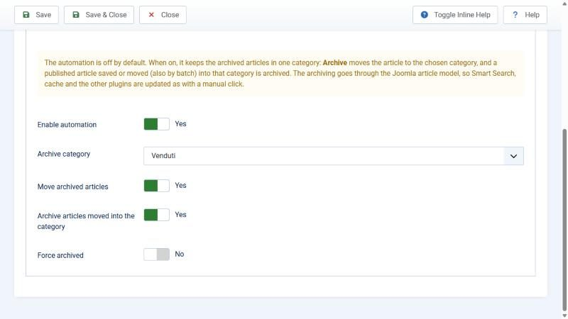

# Archive Layouts for YOOtheme: user guide

For **site managers**: install, build the archive page with the YOOtheme Pro builder, switch on
the automation, update, uninstall. Everything from the Joomla and YOOtheme interfaces.
Italian version: [USO.md](./USO.md). Developers: [DEVELOPING.md](./DEVELOPING.md) (Italian).

## What it does

Joomla has an **Archived Articles** view (menu item *Articles > Archived Articles*), but
YOOtheme Pro cannot design it with the builder: you only get the standard list. This plugin
adds the **Archived Articles** template type to the builder, with the archived articles as
dynamic content (title, images, link, dates, category, author, tags and **all custom fields**),
pagination and the month and year filters.

Optionally it keeps archived articles in one category: click **Archive** and the article is
moved to the chosen category; move an article into that category and it is archived.

Requirements: Joomla 5 or 6, PHP 8.1+, YOOtheme Pro 5. Tested with YOOtheme Pro 5.0.51 on Joomla
6.2.0 and 5.4.10 (PHP 8.4), together with Essentials for YOOtheme Pro and 4SEO: see
[Tested compatibility](#tested-compatibility).

## 1. Install

1. Download `plg_system_yooarchive-X.Y.Z.zip` from the
   [releases](https://github.com/WebG-it/joomla-extensions/releases) or from `dist/`.
2. *System > Install > Extensions > Upload Package File*.
3. The plugin is enabled automatically. Nothing changes on the site until you create a
   template or switch on the automation.

## 2. Build the archive page

1. Create (if missing) a menu item *Articles > Archived Articles*. In its options choose the
   categories (empty = all), the order (*Article Order*, *Date for Ordering*) and the number
   of articles per page (*# Articles*).
2. Open YOOtheme Pro (backend menu *YOOtheme*), item **TEMPLATES** in the left sidebar, button
   **NEW TEMPLATE**; in *Page* choose **Archived Articles**:
   - *Limit by Categories*: the template applies only to archive menu items filtered on
     those categories (with or without child categories). Empty = every archive page.
   - *Limit by Page Number* and *Limit by Language* as for the other templates.
3. Design the layout. In the *Dynamic Content* of an element (for example a Grid) choose the
   **Archive** group (**Archivio** in an Italian interface):
   - **Archived Articles**: the list of the current page. *Start* and *Quantity* take a part
     of it; *Order* re-sorts the current page (the order across pages is the one of the menu item).
   - **Archived Article**: a single article.
   - **Archive Information**: article count, page, filtered year and month, categories and a
     ready-made **filter form** (month, year, items per page) for an HTML element. The filter
     form is the only field that returns HTML; the other text fields are escaped.
4. Add a **Pagination** element below the grid.
5. The customizer preview opens the matching archive menu item by itself.

Without an assigned template the archive page stays as it was.

## 3. Automation (off by default)

*System > Plugins > System - Archive Layouts for YOOtheme*, tab **Automation**:

| Option | What it does |
|---|---|
| Enable automation | Switches everything below on. |
| Archive category | Where archived articles go. Without a category, or if the category is deleted or trashed, the automation pauses and administrators see a warning. It must be **published**: otherwise moved articles do not appear on the public site (not even on the archive page) and administrators see a yellow warning. |
| Require create permission | On by default: move only if the user who archives can also create articles in the archive category. |
| Move archived articles | Archive (list, toolbar, edit form or API) = move to the category. |
| 301 redirect from the old address | On by default. When the category is part of the article URL, entering the archive category changes the address: the old one is redirected (301) to the new one through the Joomla *Redirects* component, for the moves made by the plugin and for the articles a user moves into the category. Needs the core *System - Redirect* plugin on (administrators see a warning if it is off). Nothing is stored when the address does not change. |
| Archive articles moved into the category | A published article saved or moved (also with *Batch*) into the category is archived. |
| Force archived | Off: an article already in the category can be republished on purpose. On: it is archived again every time. |

After each action a blue message tells what the plugin did (also how many redirects it
stored: you find them in *System > Redirects*). Smart Search, cache and versions
are updated as with a manual click.

Languages: moves ignore the language. An English article is moved to the archive category even
if that category is Italian; on a multilingual site use an archive category with language *All*.

Redirects are written by the plugin, so the user does not need permissions on the Redirects
component; they are written only for the moves allowed by the rules below. Existing redirects
for the same old address that the plugin did not create are never changed.

Permissions: an article is moved only when a logged-in user with *Edit State* on the article
archives it (and, with the option on, with *Create* in the archive category). Articles being
edited by another user are never touched. Guests and the command line never move anything.

If something goes wrong (missing permission, duplicate alias in the target category) a generic
yellow message appears; details (article ids, database error) go only to the log
`administrator/logs/plg_system_yooarchive.php`. In the frontend (article editing) messages are
shown only to users who can manage articles.

## Tested compatibility

Tested on 16-10-2026 in a local Docker environment (Apache, PHP 8.4.26, MariaDB 11.4) with all
the extensions below active together, on two sites:

| Software | Version |
|---|---|
| Joomla | 6.2.0 and 5.4.10 |
| YOOtheme Pro | 5.0.51 |
| Essentials for YOOtheme Pro (ZOOlanders) | 3.0.15 (PRO) |
| 4SEO (Weeblr) | 7.2.0.2824 (full) |

What was checked, on both Joomla versions:

- **Install, update and uninstall** of this plugin with the other extensions active. Order 1:
  this plugin installed first, then 4SEO and Essentials. Order 2: this plugin uninstalled and
  installed again with 4SEO and Essentials already active. Update from 1.1.0 to 1.2.0 and from
  1.2.0 to 1.2.1 (through the update server). PHP error log and browser console empty.
- **YOOtheme Pro**: templates of the other page types (single article, category blog, featured
  articles, Smart Search) render the same HTML with this plugin on and off (only hit counters and
  random 4SEO probes differ). Customizer opening time and page response times are the same
  within measurement noise.
- **Essentials for YOOtheme Pro**: its elements (Markdown, Social Sharing) and its sources (a CSV
  source) work in every template, including *Archived Articles*; the *Archive* group appears in
  the source picker of Essentials elements and feeds them; Essentials source filters (for
  example *Date modify*) work on the archive fields; no clash of GraphQL type or source names,
  of builder events or of template types. The customizer opens with no error.
- **4SEO**: on archive pages built with the template, title, meta description, canonical,
  structured data and breadcrumb are identical to those of the plain Joomla archive page
  (plugin off), also on numbered pages (`?start=`) and with month and year filters that have
  results (a filter with no results was not compared). The 4SEO site
  analysis follows the links of the template (articles and pagination). Sitemap with *Exclude
  archived* on: archived articles are left out; off: they are listed with their new address
  after the automation has moved them.

Not tested: the update of YOOtheme Pro to 5.0.52 with this plugin active (the package was not
available), Joomla *Workflows*.

**Notes for 4SEO users.** 4SEO does not create a redirect when an article changes URL. Keep the
option *301 redirect from the old address* on (with the core *System - Redirect* plugin on) if
the category is part of your article URLs. After archiving many articles at once, run a new
site analysis in 4SEO (*Pages > Reset analysis*) so that sitemap and canonical tags use the new
addresses. Numbered archive pages are treated by 4SEO like any other page.

With article URLs that contain the id (`/<id>-alias`) Joomla finds the article by id whatever
the category in the address, so the old URL stays live after the move (no 404) and the
redirect is not used; 4SEO then keeps the old canonical until its next site analysis.

**Notes for Essentials users.** In the *Social Sharing* element leave the shared URL empty to
share the current page: mapped to the article *Link* field it receives a non-SEF address, on the
archive template as on the YOOtheme article template (Essentials behaviour).

## 4. Update

Updates arrive in *System > Update > Extensions* like any other extension (WebG update server).

## 5. Uninstall

*System > Manage > Extensions*, search "Archive Layouts", *Uninstall*. No tables or plugin files are
left. The redirects stored by the automation stay in *System > Redirects* (their note starts with
"Archive Layouts for YOOtheme:"; delete them there if you want) and so does the log
`administrator/logs/plg_system_yooarchive.php` (and `plg_system_yooarchive.1.php`). Builder templates of type *Archived Articles* stay in YOOtheme as "not assigned" and come
back if you reinstall the plugin; the archive page goes back to the Joomla one.

## Support

Questions and bug reports: [GitHub issues](https://github.com/WebG-it/joomla-extensions/issues)
(please write the Joomla, PHP and YOOtheme Pro versions). Never post passwords, keys or
private data in an issue.
